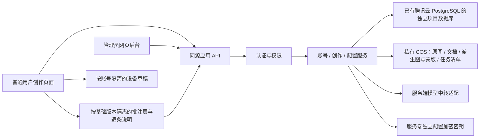

# 架构骨架：账号、模型后台、创作持久化与图片批注编辑

## 状态与决定来源

本文件描述待实现的 A1 基础与 A2 图片批注架构，二者均属于本轮开发计划；A1 可独立交付，A2 作为第四 Epic 紧随其后。当前应用代码仍无账号且尚未接入服务端数据库。用户已选择复用已购买的腾讯云 PostgreSQL，并把账号管理及现有 API 设置/模型映射的网页管理后台纳入 A1；旧图片已确认是无保留价值的测试数据。

**用户已确认：** 管理员在后台直接开账号，替代原先邮件邀请注册；首版包含网页管理后台，图片统一账号私有，停止旧图片链接和匿名生成，不导入旧测试图。独立数据库及权限已按用户授权创建并验证，但应用尚未接入。用户明确要求把图片批注式对话纳入本轮第四 Epic；应用功能、旧数据删除和生产切换尚未实施。架构保持 draft，因为认证库兼容、迁移与发布接线仍需落实。旧 AD 编号保留，变更原因见文末。

## 设计范式

保留现有 Next.js 单体部署。普通创作页面和管理页面共用服务端应用服务，通过局部模块调用认证库、PostgreSQL、COS 和模型中转。只在需要隔离秘密、归属和外部调用的位置划分职责，不先搭建通用插件平台或新的独立服务。

## 不变量与规则

### AD-1 — 服务端统一执行业务规则【方案】

- **Binds:** FR-001、FR-002、FR-004、FR-007
- **Prevents:** 管理页面和普通页面各自定义权限、配置和生成规则。
- **Rule:** 浏览器调用应用 API；服务端验证会话、账号启用状态和命令权限，再读写元数据、访问 COS 或调用模型。浏览器不直连数据库或 COS。业务规则可以用普通模块函数实现，不要求每个模块增加抽象接口。

### AD-2 — PostgreSQL 与 COS 的数据职责【复用与隔离已确认，建库权限已验证，应用待接入】

- **Binds:** FR-002、FR-003、FR-007、FR-008、FR-009、NFR-002
- **Prevents:** 与 Green PMS 混表、共享高权限账号，或把图片复制到服务器磁盘。
- **Rule:** 复用现有腾讯云 PostgreSQL 实例，为本项目使用独立数据库、独立最小权限运行账号和受控迁移身份；不沿用 Green PMS 的业务库或凭据。账号、会话、创作、版本关系、任务索引、已提交批注快照与模型配置存 PostgreSQL；图片、文档、批注派生图/蒙版和任务清单字节仅存私有 COS。数据库只保存对象引用，不存图片字节。共享实例仍共享资源和维护窗口，不把逻辑隔离称为物理隔离。

### AD-3 — 归属与管理权限分开【方案】

- **Binds:** FR-001、FR-002、FR-006、FR-007
- **Prevents:** 伪造用户 ID 越权，或管理员因能管理模型而默认读取所有创作。
- **Rule:** 只设管理员、普通用户两个应用角色；管理员维护账号及一套共享 API 配置/模型映射，创作内容仍按所有者授权。会话确定当前用户；客户端的用户 ID、对象键、父版本或模型 ID 不授予权限。创建/重置账号、配置变更只允许服务端验证过的管理员；角色和会话变更可审计，不记录密码或 Token。

### AD-4 — 成功版本的提交边界【方案】

- **Binds:** FR-003、FR-004、NFR-004
- **Prevents:** COS 有图片但数据库没有成功记录，或数据库宣称成功但没有可用原图。
- **Rule:** 服务端登记任务及归属，在收费调用前成功写入 COS 任务清单；验证父版本属于当前创作且成功，读取原始基准图。只有输出图片和完成清单写入 COS、版本记录事务提交到 PostgreSQL 后才向账号客户端报告保存成功。COS 与数据库不假装共享事务；部分失败保留任务/对象关联，以同一任务核对和补记元数据，不能重新调用模型来修复保存。失败或取消不覆盖成功版本；结果不明必须明确提示，不能假定取消即未计费。

### AD-5 — 新账号空间与本地草稿【方案】

- **Binds:** FR-002、FR-003、FR-004、FR-005
- **Prevents:** 同设备不同账号串草稿，或为了旧测试数据增加长期迁移系统。
- **Rule:** 新账号从空白空间开始，不自动导入旧匿名 workspace。账号创作与版本以服务端为准；为保留当前体验，同设备草稿和未提交文件按用户 ID 与创作 ID 隔离保存，展示前验证当前会话。退出/换号清除页面中的旧账号状态，迟到请求结果不得进入新账号。跨设备草稿同步和旧测试数据导入不属于 A1；本轮不清理已有本地记录。

### AD-6 — 统一账号私有图片【用户已确认】

- **Binds:** FR-005、FR-006、NFR-003
- **Prevents:** 旧 bearer 路由、参考图读取或结果签发绕过新账号授权。
- **Rule:** 账号版的查看、下载、基准图/参考图读取和文档读取均检查有效会话及归属；生成结果只返回应用对象标识/受保护地址，不再签发长期 bearer 链接。旧能力读取入口停止服务，无归属的旧测试对象不自动分给任何账号。新账号对象使用旧应用图片路径校验无法接受的独立命名空间，仍在 image-playground/ 内；不能只增加一个私有 GET 路由。无授权请求不得泄露对象是否存在；本轮不删除旧对象、不轮换 ASSET_ACCESS_SECRET。

### AD-7 — 复用现有设置与服务端秘密保管【用户已明确】

- **Binds:** FR-004、FR-007、NFR-001
- **Prevents:** 将搬迁设置扩展成多供应商平台，或普通用户通过旧接口覆盖后台配置、获取秘密。
- **Rule:** 首版一套共享 Base URL/Token/apiMode 和当前形状的映射列表（稳定 id、name、modelId），复用现有 API 设置与映射编辑器。保留同步/手填、增删改排序、草稿取消和明确保存；不新增供应商实体列表或逐用户模型权限。管理员可用未保存草稿测试模型列表，测试不会保存全局配置；已存秘密由服务端取用不回显，新输入只在受保护请求中短暂传递。更换 Base URL 需重新输入 Token，不静默携带旧秘密到新地址。保存的 Token 服务端加密，主密钥独立于业务库和制品。普通请求仅提交映射 ID；服务端固定受理时的配置快照，删除/改映射不改写历史，也不自动切换模型。

### AD-8 — 数据库与私有访问的发布边界【方案】

- **Binds:** FR-005、FR-006、NFR-002、NFR-003
- **Prevents:** 绕过现有无数据库检查上线，或回退旧 demo 重新开放私有数据访问。
- **Rule:** 实施时同步增加制品策略、发布工具和服务器入口对数据库迁移的支持，不能只把 databaseMode 改值或放宽校验。迁移只针对本项目数据库，先扩展后收缩；在兼容窗口内回退应用不回滚已写入业务数据。只允许验证过的账号版作为回退目标；退回无账号 demo 不是完整回退，必要时用维护状态并关闭相关入口。数据库备份与恢复演练覆盖密钥恢复；同实例恢复不得覆盖其他项目库。部署仍沿用人工 Publish、双端口切换和排空；测试不触及生产数据或收费模型。

### AD-9 — 稳定错误与最小审计【方案】

- **Binds:** FR-001、FR-003、FR-006、FR-007、NFR-004
- **Prevents:** 跨模块无法判断权限、存储、调用和保存失败，或错误响应暴露秘密。
- **Rule:** 区分会话失败、权限拒绝、写入冲突、限流/并发限制、数据库/COS/供应商失败和结果未知；返回安全消息与非秘密关联 ID。日志记录账号/模型配置变更的操作者和结果，不记录密码、完整 Token、带凭据 URL、签名参数或原始上游正文。任务清单不直接作为浏览器可读日志返回。

### AD-10 — 管理员开账号与恢复【用户已确认】

- **Binds:** FR-001、NFR-001
- **Prevents:** 为小规模使用引入邮件系统，或用默认密码、长期临时密码和公开初始化入口代替认证。
- **Rule:** 由管理员在后台直接开设账号，关闭公开注册和邮件邀请流程；管理员创建普通用户及一次性临时密码，通过现有可信渠道交付。首次登录或管理员重置后，只允许改密和退出，完成改密才可创作；临时密码限时、单次使用且不可回查。禁用和重置立即撤销旧会话，重置前管理员核验身份。首位管理员由受控的一次性维护入口初始化，不在 Git 放默认密码；禁止移除最后一位可用管理员。使用成熟认证库处理密码哈希和会话，安全 cookie、请求防伪和登录速率限制不可省略；不自行设计密码协议。

### AD-11 — 最小并发与幂等【方案】

- **Binds:** FR-003、FR-004、NFR-002
- **Prevents:** 多设备保存互相覆盖、重复点击造成重复收费，或版本号撞号。
- **Rule:** 服务端分配并约束 creationId 内唯一版本号和合法父版本，客户端版本号只作提示。修改使用 revision 条件检查；冲突保留草稿并要求刷新，不做自动合并。生成幂等键绑定账号、创作及请求内容；同键同请求只返回既有状态，不二次调用模型，同键不同请求拒绝。未知收费结果先核对，不自动重发。共享实例连接池有明确上限，不能按请求无限新建连接。

### AD-12 — 基本调用保护与公网请求边界【保留必要保护】

- **Binds:** FR-004、FR-007、NFR-001
- **Prevents:** 匿名消耗平台 Token、重复调用或任意网络代理，同时防止将安全保护扩成配额产品。
- **Rule:** 已登录且启用的账号共用后台保存的有效映射；请求受理前检查账号、配置完整性、映射仍存在以及短时速率/并发限制，阈值由服务端配置给出。幂等和在途请求保护复用 AD-11；首版不建设逐用户模型分配、日/月额度账本或配额设置界面。继续执行 HTTPS、公网 DNS 校验、连接地址固定、内网/重定向拒绝、大小和超时限制，管理员身份不能绕过。保存/同步模型列表不进行生图；监控和健康检查不调用模型、不写 COS。

### AD-13 — 批注绑定不可变基准与原图坐标【A2 方案】

- **Binds:** FR-002、FR-004、FR-008、FR-009
- **Prevents:** 图片缩放或切换版本后批注错位、不同账号串草稿，或标记合成图替代原始基准。
- **Rule:** 每组批注绑定账号、创作、不可变的 `baseVersionId` 及原图对象/宽高；每条标记保存稳定 ID、画框/圈选/涂抹类型、原图像素坐标或路径、必要的笔刷宽度和对应说明。选区浮动输入框默认在选区上方，图上标记与主对话框的编号引用共同读取同一条批注草稿；输入/编辑/删除实时同步，点击引用可定位选区，不维护独立的文本副本。局部输入不会单独触发生图，统一发送时冻结整体要求与全部有效批注。缩放仅是展示变换，服务端按真实原图尺寸校验有限数值与合法范围。草稿按用户、创作、基础版本分开，同设备恢复不承诺跨设备同步；切换基准不自动转移坐标。原图与批注叠加层独立，合成辅助图不能成为唯一编辑基准；提交后保存不可变快照，后续草稿改动不能重写历史。

### AD-14 — 批注提交、授权与版本追溯【A2 方案】

- **Binds:** FR-003、FR-004、FR-006、FR-007、FR-009、NFR-001、NFR-002、NFR-004
- **Prevents:** 模型未收到区域说明却被报告为批注编辑、图片私有路径被辅助素材绕过，或重试保存导致重复收费。
- **Rule:** 服务端校验批注、基础版本与原图属于当前账号和创作，再根据映射中明确且经过核验的能力，选择辅助图、蒙版或可验证的文字坐标表达；能力证据绑定实际供应商地址、接口类型、模型与配置版本，换绑使旧证据失效，不能只按 mappingId 复用；原始基准图始终作为输入保留。任务记录结构化批注快照、逐条说明、基准引用、采用的表达方式和配置版本；所有必需输入无法满足接口数量/格式限制时，在收费调用前拒绝，不丢弃批注、不退回普通生图。辅助图/蒙版只在服务端内存中处理并写入私有 COS，读写遵守与原图相同的归属检查。幂等指纹包含基础版本与批注内容；任务和成功新版本延续 AD-4/11 的提交边界与父版本关系。自动化验证传递正确性，不能据此保证像素精确编辑；实际模型效果必须在另获收费调用授权后验收。

## 结构与运行边界

应用保持现有 Node / Next standalone、Nginx、systemd 部署。数据库通过已核实的私网路径连接，权限与连接数在接入前验证；开发/CI 使用隔离测试库或模拟适配器。已有中转/COS模块优先复用，不为目录整齐重写创作流程。

## 能力到规则

| 能力 | 主要规则 |
| --- | --- |
| FR-001 账号和管理权限 | AD-1、AD-3、AD-10 |
| FR-002 创作归属 | AD-2、AD-3、AD-5 |
| FR-003 持久化和恢复 | AD-2、AD-4、AD-8、AD-11 |
| FR-004 创作体验 | AD-4、AD-5、AD-7、AD-11、AD-12 |
| FR-005 旧测试数据 | AD-5、AD-6、AD-8 |
| FR-006 私有访问 | AD-3、AD-6、AD-8 |
| FR-007 网页模型后台 | AD-3、AD-7、AD-9、AD-12、AD-14 |
| FR-008 图片批注与草稿 | AD-3、AD-5、AD-13 |
| FR-009 批注提交与追溯 | AD-2、AD-4、AD-6、AD-7、AD-11、AD-13、AD-14 |
| NFR-005 可访问性 | 沿用现有组件；登录、改密、后台及批注说明/提交操作保留键盘、加载/空态/错误反馈，不因流程简化删掉必要状态 |

## 接入核验与剩余问题

- 数据库已选择腾讯云 PostgreSQL；现有实例身份、负载、网络和当前 Green PMS 连接的只读核验结果同步记录于 PRD 第 8 节。已创建 `qintopia_image`、`app` schema、普通运行账号 `qintopia_image_app` 和普通迁移账号 `qintopia_image_migrator`，完成认证/CRUD/默认授权和DDL拒绝验证；详见 [数据库准备记录](../../operations/account-database-setup.md)。业务表、应用接线和备份恢复仍待实施验证。
- 管理员直接开户、首版网页管理后台与统一私有访问已成为实施规则，替代原邀请制与旧链接兼容；不做旧测试数据导入。
- 认证库版本及现有 Next.js 适配、密码恢复实现、独立主密钥的保管/恢复、服务端保护阈值和数据库迁移工具在实现前完成核验；本轮文档更新不安装服务或购买资源。
- A2 开工前核验模型映射对辅助图、蒙版或文字坐标的真实支持及输入限制，冻结相应契约；不在规划阶段指定具体模型、付费预算或承诺精确编辑效果。

## 交付顺序与延后范围

A1 交付账号与用户管理、模型管理后台、私有创作空间；A2 作为本轮第四 Epic，紧随 A1 交付图片批注式对话编辑，依赖 A1 的身份、模型映射、私有素材和版本记录。A1 可以独立交付，不能把该顺序解释为 A2 不在开发清单。

跨设备草稿同步、后台任务续跑、多人批注/评论协作、专业复杂画布、主动分享、开放注册、邮件自动化、多供应商目录、逐用户模型分配、额度账本、充值计费和复杂权限体系仍延后。基本冲突拒绝和幂等已纳入 A1/A2，不能以“复杂同步延后”为由省略。

## 决策变更记录

2026-10-28：沿用既有 AD 编号；依据用户选择将网页模型后台前移并确定优先复用腾讯云数据库。AD-7 从设备端配置改为后台统一配置；AD-2/8 加入共享实例与迁移边界。因用户说明旧图无价值，AD-5/6 提出不迁移与统一私有方案；AD-10 提出管理员开户替代邮件邀请。这两项在该次草案中尚待确认，当时未执行旧数据删除、真实模型调用、数据库建库/授权或生产切换。

2026-10-28（用户确认）：AD-6 的统一私有访问与 AD-10 的管理员直接开户获确认，首版网页管理后台维持已确认范围；AD-2 的独立数据库及权限获实际创建授权。独立库、账号及权限已创建验证；保留旧库 PUBLIC CONNECT 的实际边界，没有修改其他项目 ACL。应用功能、真实模型调用和生产切换尚未实施，不据此标记架构 final；旧测试数据删除仍不在授权范围内。

2026-10-28（范围补全）：图片批注式对话进入本轮第四 Epic / A2，紧随 A1，新增 AD-13/14 并保留既有编号；明确原图像素坐标、不可变基础版本、逐条说明、映射能力校验、私有派生素材及请求正确性与模型效果的验收区别。修正建库状态为权限已验证、应用待接入；本轮仅更新文档。

2026-10-28（奥卡姆复核）：按用户澄清收窄 AD-7/12，现有单套 API 配置与映射直接迁到后台；加密/授权和基本限流属于必要边界，不建设多供应商、用户模型矩阵和配额产品。批注、私有版本、其他应用数据库保护保持。

2026-10-29（交互确认）：AD-13 补充选区上方输入框与主对话框编号引用的共享草稿规则；属于图片批注的具体交互约定，不新增通用聊天系统。
